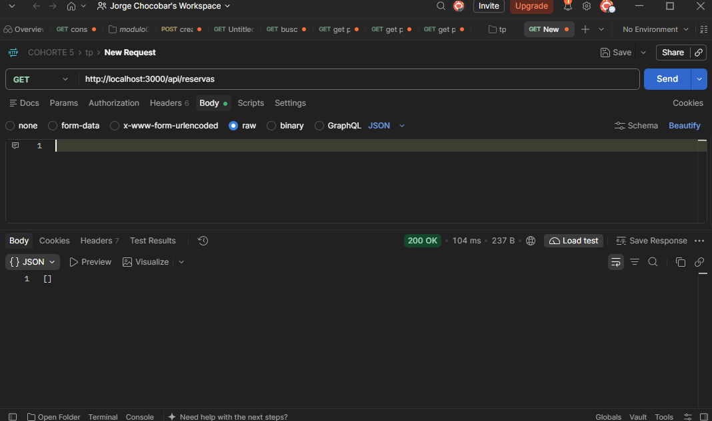
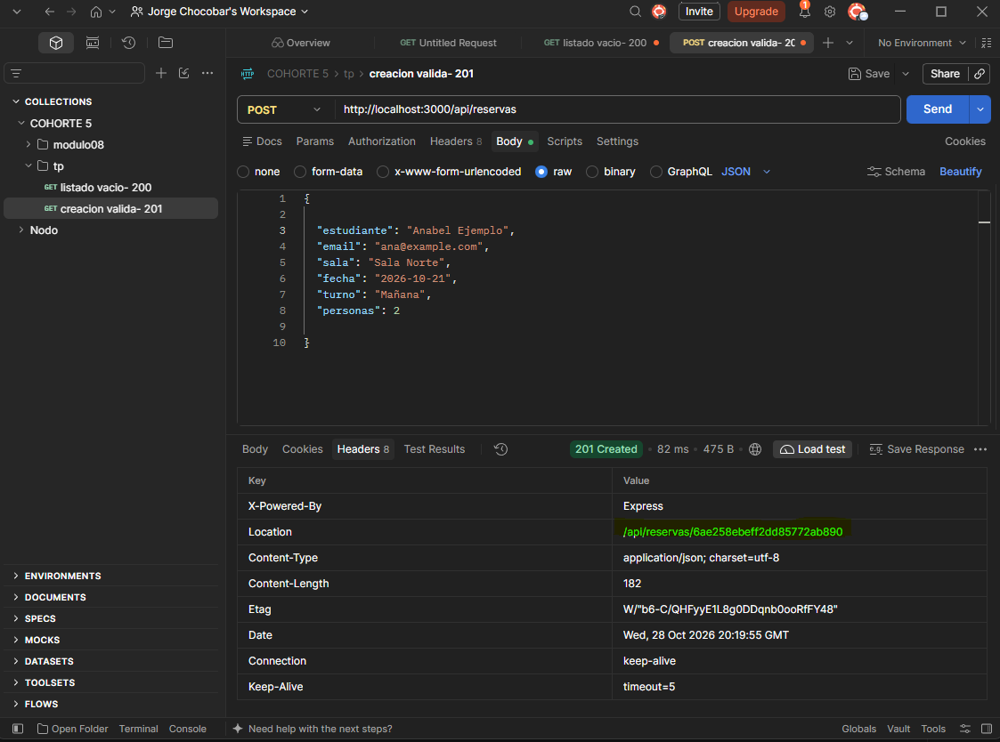
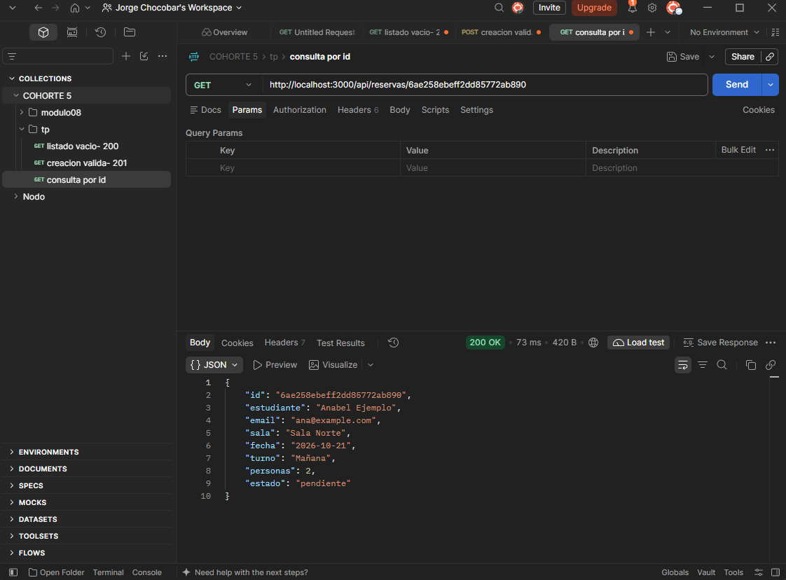
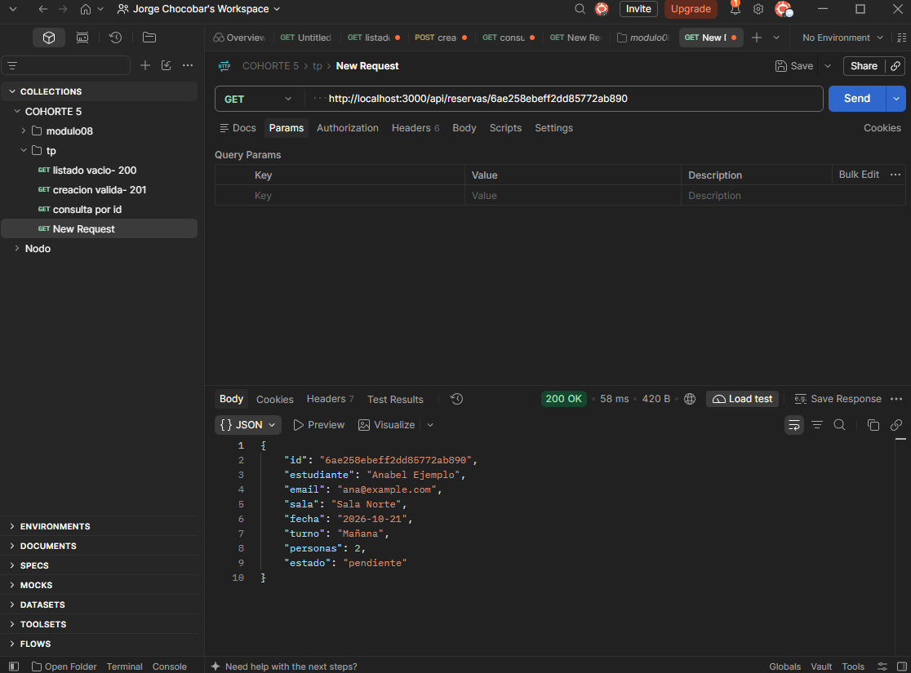
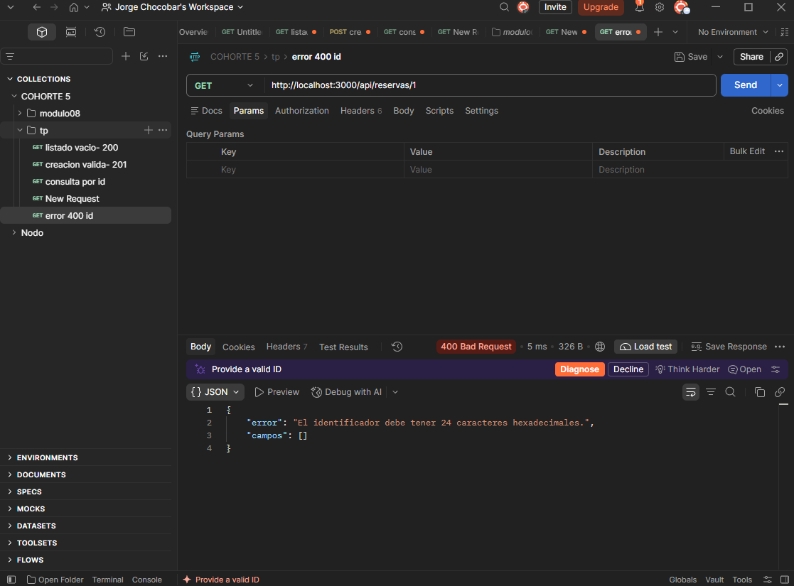
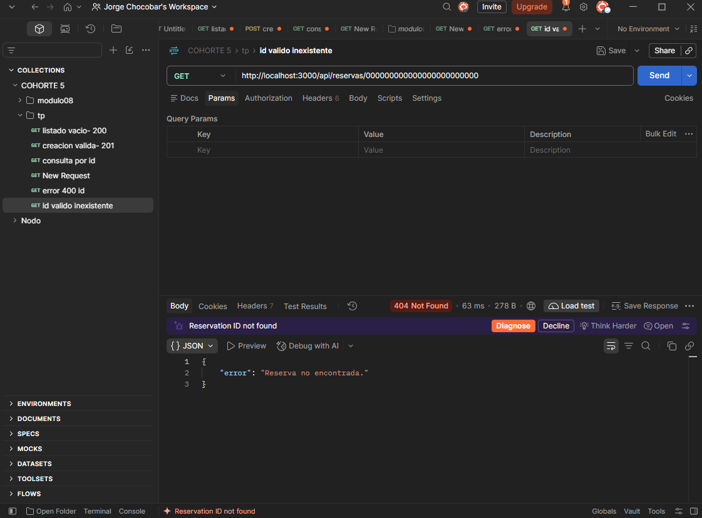

# Trabajo práctico 08 - Endpoints persistentes de reservas de salas

Reservas de salas de estudio (Express 5 + EJS) con persistencia en MongoDB Atlas mediante Mongoose. El sitio HTML y la API JSON usan **el mismo servicio asíncrono** y leen los mismos documentos.

## 1. Origen de la copia

Copia funcional del TP 07 (`tp-07-salas-mongodb`), renombrada `tp-08-salas-http-mongodb`. El TP 07 se conserva intacto en su propia carpeta. No se copiaron historial Git, `node_modules` ni `.env`. Se mantuvieron versiones, manifiesto y lockfile.

## 2. Versiones

| Elemento | Versión |
| --- | --- |
| Node.js | _completar con `node -v` (requerido: >=22.13.0)_ |
| npm | _completar con `npm -v`_ |
| express | ^5.2.1 |
| ejs | ^6.0.1 |
| express-ejs-layouts | ^2.5.1 |
| mongoose | ^9.11.4 |
| morgan | ^1.12.1 |
| eslint / prettier | ^10.12.0 / ^3.9.10 |

El proyecto usa módulos CommonJS.

## 3. Preparación de Atlas

1. Clúster **Free (M0)** (se puede reutilizar el de las clases).
2. En _Database Access_: usuario con permiso de lectura y escritura sobre `reservas_salas_u8`.
3. En _Network Access_: permitir la IP desde la que se ejecuta el programa.
4. En _Connect → Drivers → Node.js_: copiar la URI `mongodb+srv://...`.
5. Base `reservas_salas_u8`, colección `reservas` (Mongoose la crea al guardar la primera reserva).

## 4. Entorno, DNS y arranque

```
npm install
cp .env.example .env
```

En `.env`, reemplazar `USUARIO`, `CLAVE` y `HOST` por datos reales y conservar la base `reservas_salas_u8` y las opciones `?retryWrites=true&w=majority`. El nombre `HOST` de la plantilla es un marcador: no permite conectar. **El `.env` no se entrega** (está en `.gitignore`).

Variables: `PORT`, `NODE_ENV` y `MONGODB_URI`.

**DNS.** En `src/config/base-datos.js` se ejecuta una sola vez `dns.setServers(["8.8.8.8", "1.1.1.1"])` (corrección acordada para resolver los registros SRV/TXT de Atlas). No cambia el DNS del sistema, la autenticación ni la lista de IPs.

**Comando de inicio:**

```
npm run start:local        # equivale a: node --env-file=.env src/index.js
```

El arranque lee el entorno, **espera la conexión a MongoDB** y recién entonces escucha el puerto. Si falta `MONGODB_URI`, la URI es inválida o falla la red/DNS, el servidor no abre el puerto ni anuncia que está disponible. La conexión se mantiene entre solicitudes. Con `SIGINT` o `SIGTERM` (Ctrl+C) se cierra el servidor HTTP y luego la conexión.

Otros comandos:

| Tarea | Comando |
| --- | --- |
| Probar conexión | `node --env-file=.env scripts/comprobar-conexion.js` |
| Crear una reserva (terminal) | `npm run crear` |
| Listar reservas (terminal) | `npm run listar` |
| Formatear / verificar | `npm run format` / `npm run check` |

## 5. Estructura por capas

```
src/
├── index.js                 # arranque: entorno -> conexión -> listen -> cierre ordenado
├── app.js                   # Express, middleware, routers, 404 y errores
├── config/                  # entorno.js, base-datos.js (conexión y DNS)
├── modelos/reserva.js       # esquema Mongoose (reglas del documento)
├── servicios/
│   ├── reservas-mongo.js    # servicio asíncrono ACTIVO (Mongoose)
│   └── reservas.js          # servicio en memoria del TP 07 (solo referencia, no se importa)
├── controladores/reservas.js# HTML y API; usan await
├── rutas/
│   ├── reservas.js          # router HTML (/reservas)
│   └── reservas-api.js      # router API (/api/reservas)
├── middleware/              # solicitudes.js, reservas.js (validación), errores.js
scripts/                     # programas de terminal
views/, public/              # sitio HTML
```

El modelo no contiene rutas HTTP y el servicio no envía respuestas.

**Qué dejó de importarse del servicio en memoria.** `index.js` ya no importa `servicios/reservas.js` ni carga el arreglo `reservasIniciales`. El archivo queda como referencia, pero no hay dos fuentes activas para el dominio de reservas.

## 6. Modelo y entrada admitida

| Campo | Regla |
| --- | --- |
| `estudiante` | String obligatorio, `trim` |
| `email` | String obligatorio, `trim`, debe contener `@` |
| `sala` | String obligatorio, enum `Sala Norte` / `Sala Sur` / `Sala Multimedia` |
| `fecha` | String obligatorio, `trim` |
| `turno` | String obligatorio, `trim`, enum `Mañana` / `Tarde` / `Noche` |
| `personas` | Number obligatorio, entero entre 1 y 6 |
| `estado` | Enum `pendiente` / `confirmada`, default `pendiente` (no lo asigna el cliente) |

Al crear se copian explícitamente solo los seis primeros campos; `estado` y `_id` enviados por el cliente se ignoran. El middleware rechaza cuerpos ausentes, texto sin parser y tipos incorrectos (booleanos, arreglos, objetos); el modelo vuelve a validar.

**Límites de validación.** Estas reglas no comprueban email completo, fecha real o futura, solapamientos, cupos compartidos ni duplicados. No hay índice único. El default `pendiente` no es autenticación, autorización ni migración de documentos anteriores.

## 7. Sitio HTML

| Ruta | Función |
| --- | --- |
| `/` | Inicio |
| `/reservas` | Listado (lee MongoDB) |
| `/reservas/nueva` | Formulario |
| `/reservas/:id` | Detalle (lee MongoDB) |
| `/estado` | JSON con `servicio`, `reservas` (conteo desde MongoDB) y `solicitudId` |

POST válido: espera la escritura y redirige 302. POST inválido: responde 400 y conserva los valores. Ruta inexistente: página HTML 404.

## 8. API JSON

| Método y dirección | Resultado |
| --- | --- |
| `GET /api/reservas` | 200 y arreglo (`[]` si no hay documentos) |
| `GET /api/reservas?sala=Sala%20Norte` | 200 y coincidencias exactas (`[]` sin coincidencias) |
| `GET /api/reservas/:id` | 200 y recurso |
| `POST /api/reservas` | 201, recurso guardado y cabecera `Location` |
| ID mal formado | 400 JSON |
| ID bien formado inexistente | 404 JSON |
| Creación inválida o JSON mal formado | 400 JSON, sin escritura |
| `sala` repetida o vacía | 400 JSON |
| Ruta `/api/...` desconocida | 404 JSON |
| Fallo inesperado | 500 JSON genérico, sin traza ni secreto |

No hay `PUT`, `PATCH` ni `DELETE`. No se publica este servidor en Internet sin las protecciones que se verán más adelante.

Ejemplo de recurso (datos ficticios):

```jsoN
{
  "id": "665f1c2e8a1b2c3d4e5f6a7b",
  "estudiante": "Ana Ejemplo",
  "email": "ana@example.com",
  "sala": "Sala Norte",
  "fecha": "2026-10-21",
  "turno": "Mañana",
  "personas": 2,
  "estado": "pendiente"
}
```

El `id` es el `ObjectId` convertido a texto; el parámetro de la URL no se convierte con `Number`.

## 9. Cómo reproducir las solicitudes en Postman

Con el servidor iniciado (`npm run start:local`) y el puerto 3000 (adaptar si se cambió):

| # | Método y URL | Body / Params | Cabecera necesaria | Respuesta esperada |
| --- | --- | --- | --- | --- |
| 1 | GET `http://localhost:3000/api/reservas` | Body: none | — | 200 y arreglo; registrar la cantidad |
| 2 | POST `http://localhost:3000/api/reservas` | Body > raw > JSON (ejemplo de la sección 8, sin `id` ni `estado`) | `Content-Type: application/json` (Postman la agrega al elegir JSON) | 201, `id`, seis campos, `estado: "pendiente"` y cabecera `Location` en la respuesta |
| 3 | GET `http://localhost:3000` + valor de `Location` | Body: none | — | 200, mismo `id` y mismos campos |
| 4 | GET `http://localhost:3000/api/reservas/1` | Body: none | — | 400 |
| 5 | GET `http://localhost:3000/api/reservas/000000000000000000000000` | Body: none | — | 404 (si ese documento no existe) |
| 6 | GET `http://localhost:3000/api/reservas` | Params: `sala` = `Sala Norte` | — | 200, solo esa sala |
| 7 | Igual que 6 con `sala` = `Sala Inexistente` | Params | — | 200 y `[]` |
| 8 | Igual que 6 con dos filas `sala` con valores distintos | Params | — | 400 |
| 9 | POST con un dato inválido por vez (ver matriz) | raw JSON | `Content-Type: application/json` | 400; volver al GET 1 y comparar cantidades |
| 10 | POST sin cuerpo | Body: none | — | 400 JSON |
| 11 | POST con JSON incompleto (por ejemplo `{"estudiante":`) | raw JSON | `Content-Type: application/json` | 400 JSON |
| 12 | POST válido con `"estado": "confirmada"` y `"_id": "x"` extra | raw JSON | `Content-Type: application/json` | 201; se crea con `_id` propio y `estado: "pendiente"` (registrarlo como reserva válida) |

El formulario y las vistas se prueban en el navegador.

## 10. Prueba de persistencia (reinicio)

1. GET sin filtros en Postman: registrar cantidad inicial.
2. POST válido: guardar `id` y `Location`.
3. GET a la `Location`: comparar datos y `estado: "pendiente"`.
4. Detener el servidor (Ctrl+C) y volver a iniciarlo con la misma base.
5. GET con el mismo `id` y localizar la reserva en `/reservas`. **No repetir el POST.**
6. Listar dos veces: la cantidad debe ser estable.
7. En Atlas, `reservas_salas_u8/reservas`: comparar el `_id`.

_Completar con los valores observados: cantidad inicial ___, id ___, cantidad tras reiniciar ___._

## 11. Matriz de resultados

La columna **Resultado observado** debe completarse solo con lo realmente probado. Las capturas de Postman deben permitir identificar método, URL, estado y resultado.

| Caso | Resultado esperado | Resultado observado | Cantidad / captura |
| --- | --- | --- | --- |
| Listado vacío (base nueva) | 200, `[]` | _OK_ | |

| Creación válida | 201 y `Location` | _OK_ | |

| Consulta por ID creado | 200, mismo recurso | _OK_ | |

| Consulta tras reiniciar | 200, mismo ID | _OK_ | |

| ID `"1"` | 400 | _completar_ | |

| ID válido inexistente | 404 | _OK_ | |

| Estudiante vacío o email sin `@` | 400, cantidad sin aumento | _ok_ | |
| Sala o turno no permitido | 400, cantidad sin aumento | _ok_ | |
| Fecha vacía | 400 | _ok_ | |


## 12. Comparación con el TP 07

| Aspecto | TP 07 | TP 08 |
| --- | --- | --- |
| Datos del sitio | Arreglo en memoria; las reservas se perdían al reiniciar | MongoDB; se conservan al reiniciar |
| MongoDB | Solo desde scripts de terminal | Sitio y API |
| Servicio | Síncrono | Asíncrono (promesas) |
| Controladores | Síncronos | `async`/`await` |
| Respuestas | Solo HTML | HTML y API JSON |
| Errores | Sin middleware de errores | Middleware de errores de cuatro parámetros; 400, 404 y 500 diferenciados |
| Identificador | Número consecutivo | `ObjectId` como texto |
| Arranque | Sin conexión | Espera la conexión y cierra ordenadamente |

## 13. Calidad y seguridad

```
npm run format
npm run check
```

El `.env` no se entrega ni se publica. No hay `node_modules`, secretos ni datos personales reales. Los diagnósticos no imprimen la URI ni la clave. Los datos de los ejemplos son ficticios.
